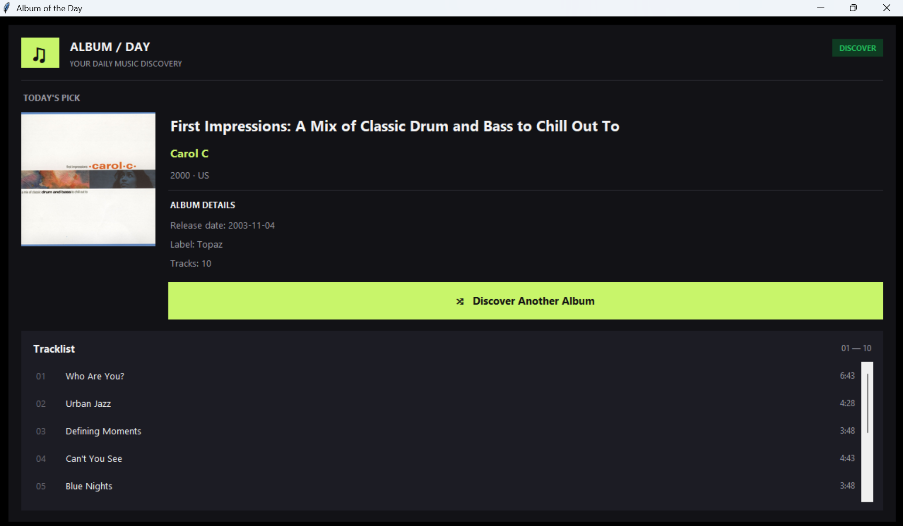

# 🎵 Album of the Day

A desktop application built with **Python and Tkinter** that discovers random music albums using the MusicBrainz API and displays their cover art, metadata, and tracklist.



## ✨ Features

- 🎲 Discover random music albums
- 🖼️ Display album cover art
- 🎤 View album details, artist, release date, and record label
- 🎶 Browse the album's tracklist and track durations
- 💾 Cache downloaded cover art locally
- 🌙 Dark-themed interface with a lime-green accent

## 🛠️ Technologies

- Python
- Tkinter
- MusicBrainz API
- Cover Art Archive
- Pillow

## 🚀 Run the Application

Install the dependencies:

```bash
pip install -r requirements.txt
```

Run the application:

```bash
python main.py
```

---

Made with Python 🎧
